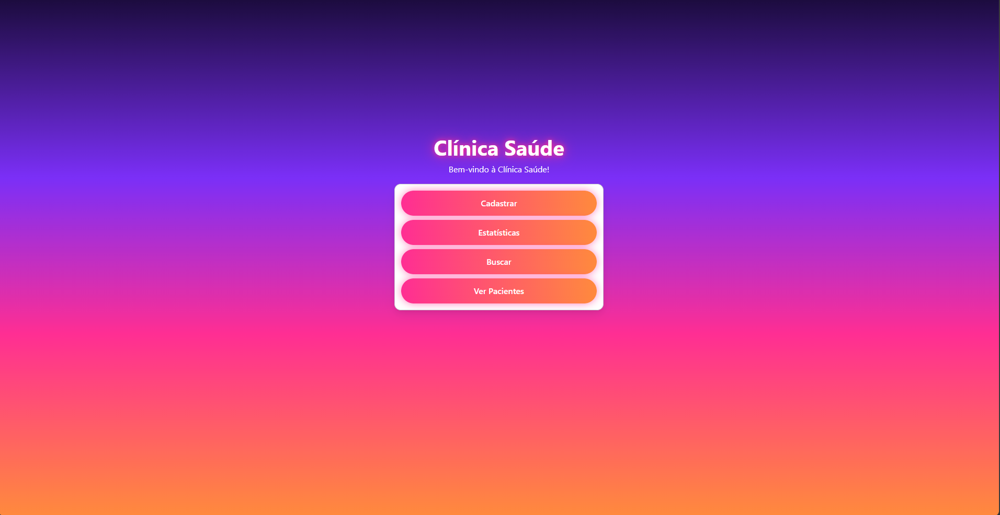
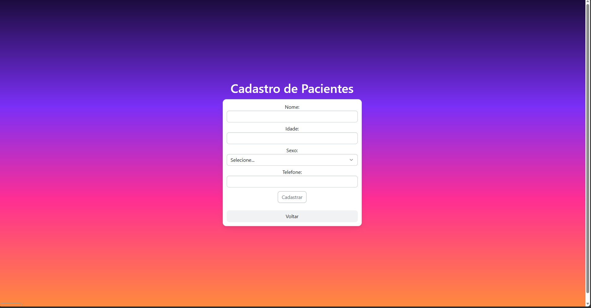
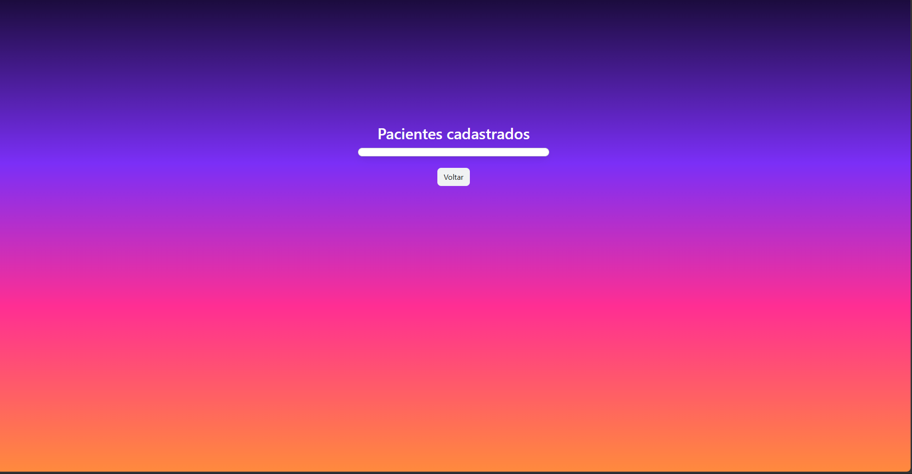
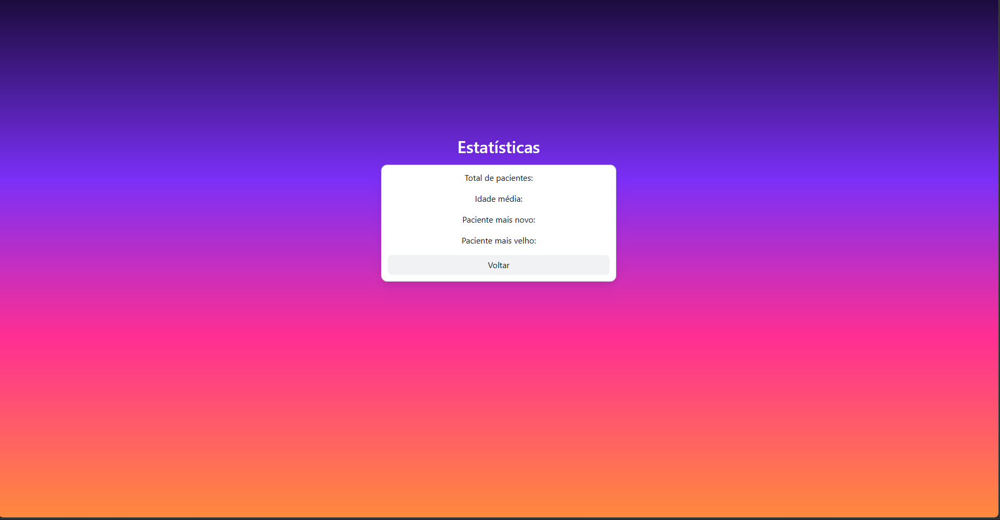

# Clínica Saúde PY

Site de uma clínica fictícia desenvolvido em Python com Flask e Bootstrap. O sistema permite gerenciar o cadastro de pacientes e consultar informações básicas sobre eles.

> Projeto acadêmico concluído em novembro de 2026.

## Funcionalidades

- Cadastro de pacientes
- Listagem de todos os pacientes cadastrados
- Busca de paciente por nome
- Cálculo da idade média dos pacientes
- Exibição do paciente mais velho e do mais novo

## Tecnologias

- [Python](https://www.python.org/)
- [Flask](https://flask.palletsprojects.com/)
- [Bootstrap](https://getbootstrap.com/)
- HTML e CSS

## Capturas de tela

### Página inicial


### Cadastro de pacientes


### Lista de pacientes


### Estatísticas


## Estrutura do projeto

```
ClinicaSaudePY/
├── app.py              # Aplicação Flask (rotas e lógica)
├── static/
│   ├── css/            # Estilos (home.css, style.css)
│   └── img/            # Capturas de tela
└── templates/          # Páginas HTML
    ├── index.html
    ├── cadastro.html
    ├── pacientes.html
    ├── buscar.html
    └── estatistica.html
```

## Autor

**Iuri Dias de Castro**
[GitHub](https://github.com/iuri-Castro)
